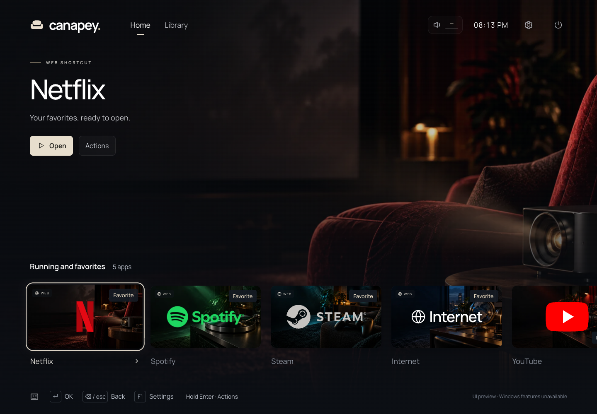
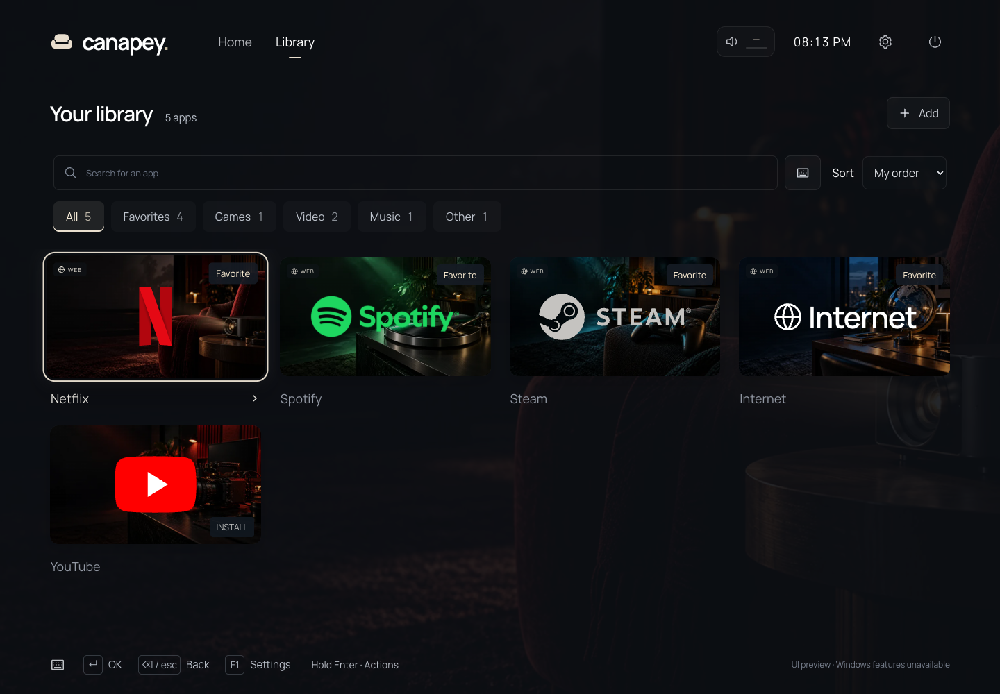
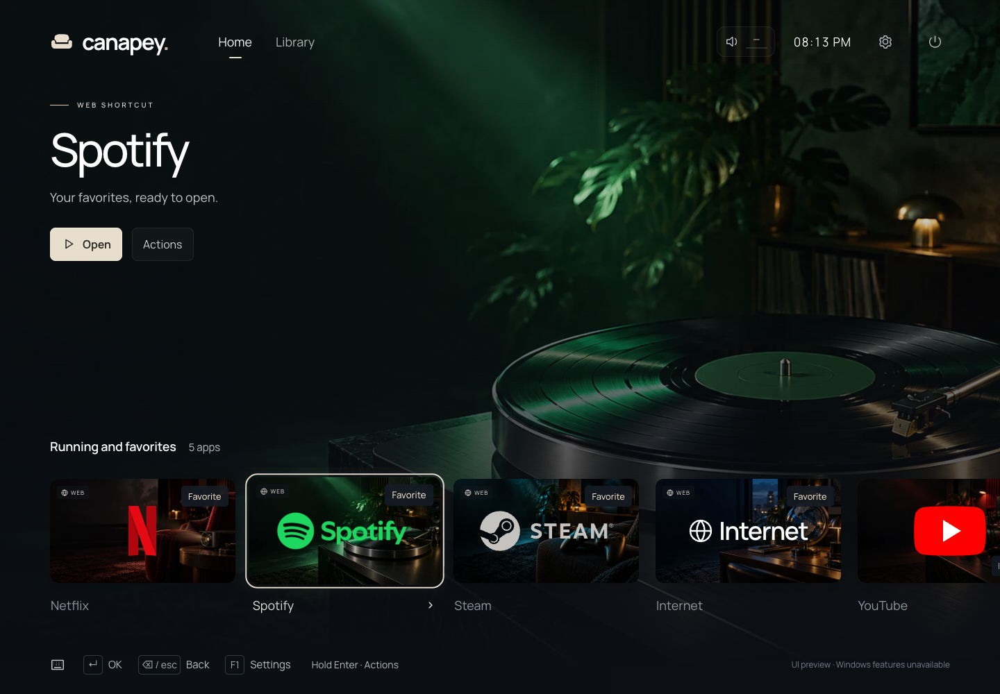

<p align="center">
  
</p>

<h1 align="center">Canapey Launcher</h1>

<p align="center">
  <strong>Your PC. From the sofa.</strong>
</p>

<p align="center">
  A quiet, controller-first home for your Windows living-room PC.<br>
  Browse your apps, pick something to play, watch or listen to, and settle in.
</p>

<p align="center">
  
  <a href="https://github.com/DwennK/canapey-launcher/releases"></a>
  
</p>

<p align="center">
  <a href="https://github.com/DwennK/canapey-launcher/releases/tag/v0.2.0"><strong>Windows downloads</strong></a> ·
  <a href="#quick-start">Build from source</a> ·
  <a href="CHANGELOG.md">Release notes</a> ·
  <a href="https://github.com/DwennK/canapey-launcher/issues">Report an issue</a>
</p>

<br>

<p align="center">
  
  <br><sub><strong>Make yourself at home.</strong> A full-screen carousel, cinematic backdrops and your favourite apps within reach.</sub>
</p>

<p align="center">
  <a href="#a-look-around">A look around</a> ·
  <a href="#why-canapey">Why Canapey</a> ·
  <a href="#what-it-does">What it does</a> ·
  <a href="#downloads">Downloads</a> ·
  <a href="#controls">Controls</a> ·
  <a href="#quick-start">Quick start</a> ·
  <a href="#under-the-hood">Under the hood</a>
</p>

## A look around

<table>
  <tr>
    <td width="50%" valign="top">
      
      <p><strong>Your space, at a glance.</strong><br><sub>Move from the home carousel to the library grid without losing your selection.</sub></p>
    </td>
    <td width="50%" valign="top">
      
      <p><strong>A different mood for every app.</strong><br><sub>Bundled artwork sets the scene. Custom cards and backgrounds make it yours.</sub></p>
    </td>
  </tr>
</table>

<sub>Actual browser UI previews at 1440 × 900. The interface is currently in French; native Windows actions are unavailable in this preview. Cards marked “À ajouter” are suggestions to add, not detected installations. Screenshots show the development interface and may differ from a released installer.</sub>

## Why Canapey

- **Made for the sofa.** Large cards, clear focus and navigation with a controller, keyboard or mouse.
- **Your apps, together.** Import Windows applications, Store apps and existing shortcuts into one personal library.
- **A home that works offline.** Artwork and fonts ship with the launcher. Everyday launcher use needs no account, server or remote service; web destinations still need a connection.
- **Windows stays yours.** Explorer keeps running. Return to the desktop, use the system tray or reopen Canapey at any time. No shell replacement.
- **Make it feel like home.** Reorder cards, import artwork, choose your screen, adjust interface size and turn motion or navigation sounds on or off.

## What it does

| Area | Available in the current implementation |
| --- | --- |
| **Home & library** | Full-screen carousel, library grid, contextual backdrops and remembered selection |
| **App discovery** | On-demand import from Start menus, desktops, App Paths and Windows packaged-app identities; no whole-drive scan |
| **Shortcuts** | Executables, Windows shortcuts and supported URIs |
| **Quick controls** | Header audio button, Windows master volume/mute, default output selection and confirmed sleep; controller-accessible side panel |
| **Controllers** | D-pad and left-stick navigation, Xbox/PlayStation button labels, configurable deadzone and a global return shortcut |
| **App sessions** | Launch, resume and request a normal close for identifiable apps; return when their last tracked window closes |
| **Personalisation** | Card ordering, bundled themes, custom card/background images and interface scaling |
| **Desktop integration** | Optional start at login, single instance, tray access, preferred monitor and primary-screen fallback |
| **Local storage** | Validated configuration, automatic backup, local artwork and rotating diagnostic logs |

> [!IMPORTANT]
> **Canapey is experimental.** The `0.x` installers are test prereleases without an Authenticode signature. Releases built with the signed updater workflow support in-app updates; v0.1.0 and v0.2.0 still require a manual installer download. Windows may show a SmartScreen warning. Interactive testing on a real Windows PC and physical controllers is still pending; builds and browser previews do not establish native compatibility. See the [validation record and hardware checklist](docs/VALIDATION.md).

## Downloads

**Current project version: 0.2.0.** Download the Windows installer from [the v0.2.0 prerelease](https://github.com/DwennK/canapey-launcher/releases/tag/v0.2.0), alongside its release notes and `SHA256SUMS.txt`.

| Platform | Distribution | Status |
| --- | --- | --- |
| **Windows 11 · x64** | NSIS `.exe` installer, installed for the current user | Experimental target |
| Windows 10, x86 or ARM64 | — | Unsupported |
| macOS / Linux | Browser UI development preview | No native launcher support |

WebView2 is required and is usually present on Windows 11. The bundled bootstrapper needs internet access if it must install WebView2. Once installed, Canapey's home screen works offline.

On first launch, choose **Add applications** to discover installed applications or browse for an executable or Windows shortcut. Select the applications you want, then choose **Add**. System tools are hidden by default; enable **Show system tools** to include them. Applications already in your library are marked and cannot be selected again. Previously saved web shortcuts remain available in your library.

## Controls

| Action | Keyboard | Controller |
| --- | --- | --- |
| Move between cards, buttons and fields | Arrow keys | D-pad / left stick |
| Choose, open, toggle, or start/finish editing a field | <kbd>Enter</kbd> | A / Cross |
| Go back or leave field editing | <kbd>Backspace</kbd> / <kbd>Esc</kbd> | B / Circle |
| Open the library from the carousel | <kbd>↓</kbd> | Down |
| Return to the carousel from the first grid row | <kbd>↑</kbd> | Up |
| Open card actions | Hold <kbd>Enter</kbd> for 600 ms | Hold A / Cross for 600 ms, or X / Square |
| Open settings | <kbd>F1</kbd> | Start / Options, on release |
| Return globally without closing the running app | — | Hold Start + Back for 1.2 seconds |
| Ask to quit Canapey | <kbd>Ctrl</kbd> + <kbd>Shift</kbd> + <kbd>Q</kbd> | — |
| Windows fallback to close Canapey | <kbd>Alt</kbd> + <kbd>F4</kbd> | — |

The **Quick controls** button sits immediately to the left of the clock. In its side panel, Up/Down moves through controls, Left/Right adjusts the focused volume slider by 2 percentage points, A / Cross or Enter selects an output or toggles mute, and B / Circle or Esc closes the panel. Sleep requires confirmation and initially focuses Cancel. Audio reflects the Windows default playback device; output selection changes the console, multimedia and communications defaults. Apps pinned to another output may retain their own routing. See [audio implementation and validation](docs/AUDIO.md) for platform limits and the hardware checklist.

On added application cards, a short Enter / A / Cross press activates on release. A long press shows progress and opens card actions without launching on release. Right-click or touch-and-hold also opens the menu; touch scrolling cancels the gesture. Edit, move and remove cards here, or resume and close tracked sessions. Back / Esc dismisses the menu and restores the selected card. Suggestions and system cards keep their usual action.

The global shortcut can be disabled or changed to **LB + RB + Start** (L1 + R1 + Options on PlayStation), with an adjustable hold duration. Other controller input is ignored while Canapey is in the background. Release the shortcut before resuming navigation.

<details>
<summary><strong>Field editing, focus and controller compatibility</strong></summary>

- Arrow keys move focus between controls. Press Enter / A / Cross on a text field, selector or slider to begin editing; press it again to finish. Clicking or typing in a text field also starts editing.
- While editing text, arrows move the caret and **Backspace deletes text**. Esc / B / Circle ends editing without closing the menu. Shift + Enter adds a line in the arguments field. Outside editing, Backspace returns to the previous menu.
- From the carousel, Up reaches the main action and then the header. From the last grid row, Down reaches the power control; Up returns to the cards. Tab stays inside an open dialog. Confirmations focus **Cancel**, and going back restores the original control.
- Settings, multi-app import, ordering, themes, confirmations and power controls support controller navigation. Entering a path or URI and choosing files may still require a keyboard or a Windows dialog.
- **Steam Input** can intercept Start/Back or map a controller to keyboard/mouse input through its Desktop Layout. Disable that mapping for Canapey or choose the alternative shortcut. Canapey does not automatically disable duplicate Steam Input and native input.
- Controllers must be exposed to Windows in a format supported by gilrs / Windows Gaming Input. Canapey does not install PlayStation drivers.

</details>

## Quick start

For native development: **Windows 11 x64**, Node.js **24 LTS** (or a supported version from `package.json`, including 22.12+ on the 22.x line), Rust **1.90+**, Visual Studio Build Tools with **Desktop development with C++**, the Windows SDK and WebView2.

```sh
git clone https://github.com/DwennK/canapey-launcher.git
cd canapey-launcher
npm ci
```

**Run the Windows desktop app:**

```sh
npm run desktop
```

**Preview the interface in a browser**, including on macOS or Linux:

```sh
npm run dev
```

Open [127.0.0.1:1420](http://127.0.0.1:1420). The preview uses isolated browser storage and allows interface and settings previews. Its visible preview label identifies the mode: it does not simulate Windows launches, discovery, Rust controller input or successful updates.

**Build the Windows installer** on Windows 11 x64:

```powershell
npm run tauri -- build --target x86_64-pc-windows-msvc --bundles nsis
```

Output: `src-tauri/target/x86_64-pc-windows-msvc/release/bundle/nsis/`.

<details>
<summary><strong>Cross-compiling from macOS</strong></summary>

With `cargo-xwin`, LLVM and NSIS installed:

```sh
PATH="/opt/homebrew/opt/llvm/bin:$PATH" npm run tauri -- build --runner cargo-xwin --target x86_64-pc-windows-msvc --bundles nsis
```

This produces a Windows installer; it does not prove that the app runs correctly on Windows. The [Windows CI workflow](.github/workflows/ci.yml) also builds an installer and retains it as a test artifact.

</details>

## Under the hood

**Tauri 2 + Rust** handle Windows integration. **Vue 3 + TypeScript** render the interface. Bundled artwork and Manrope keep the home screen self-contained.

| Location | Responsibility |
| --- | --- |
| [`src/App.vue`](src/App.vue), [`src/components/`](src/components/), [`src/lib/`](src/lib/) | Interface, spatial focus, navigation and IPC bridge |
| [`model.rs`](src-tauri/src/model.rs), [`config.rs`](src-tauri/src/config.rs), [`input.rs`](src-tauri/src/input.rs), [`tracking.rs`](src-tauri/src/tracking.rs) | Core logic that can be tested without a desktop runtime |
| [`runtime.rs`](src-tauri/src/runtime.rs) | Validated commands, app sessions, displays, single instance, logs and updates |
| [`platform/windows.rs`](src-tauri/src/platform/windows.rs), [`discover.ps1`](src-tauri/src/platform/discover.ps1) | Windows app discovery, activation, process and window integration |
| [`public/art/`](public/art/), [`public/fonts/`](public/fonts/) | Bundled artwork, thumbnails and fonts |

<details>
<summary><strong>Discovery, launching and session tracking</strong></summary>

Discovery runs only when requested, after the home screen is visible. It examines user/common Start menus and desktops, **App Paths** registry keys and packaged identities returned by **Get-StartApps**. Searches are bounded to 600 shortcuts per root, 1,500 results and 60 seconds.

A fixed PowerShell script uses WScript.Shell to resolve `.lnk` files while retaining arguments and working directories. `CommandLineToArgvW` parses arguments. Executables use `std::process::Command` with an argument list; unresolved shortcuts and URIs use `ShellExecuteExW`; Store identities use `IApplicationActivationManager`. User paths are never concatenated into shell commands or scripts. If AppLocker or PowerShell policy blocks discovery, manual `.exe` entry remains available.

Allowed URI schemes: `http`, `https`, `steam`, `spotify`, `ms-xbox`. UNC paths, `.bat` / `.cmd` scripts and additional arguments for URI or packaged-app targets are deliberately rejected.

Tracking uses **PID + creation time**, follows descendants and recognises existing non-browser instances by exact executable path. When the last associated window disappears, Canapey returns after a short delay; the first process exiting alone does not trigger a return. Apps with no window after 20 seconds are marked untracked, or removed from tracking if no relevant process remains. No process is killed by name.

Normal close requests use `WM_CLOSE`. After five seconds, the interface may offer an explicitly confirmed force close, restricted to processes started by Canapey and their identified descendants. Existing instances cannot be force-closed. Tracked sessions remain available in Diagnostics even after their card is removed.

**Tracking limits:**

- Browser and URI launches often share processes or windows. Their launch is real, but their session is not individually identifiable: use Alt + Tab to resume and the global shortcut to return. Force close is unavailable. Stopping tracking does not close the browser.
- Very short-lived launcher chains, unrelated service activations and system-hosted windows can evade association. Canapey does not adopt arbitrary PIDs to compensate. Store apps, Steam and single-instance applications need testing with the installed versions.
- Elevated, protected, windowless or exclusive-fullscreen applications may refuse inspection, closing or focus. If Windows denies focus, Canapey flashes its taskbar button.
- An application opened outside Canapey is recognised when its card is activated, rather than through a blocking startup scan.

</details>

<details>
<summary><strong>Local data, artwork, logs and desktop behaviour</strong></summary>

Windows data directory: `%APPDATA%\com.canapey.launcher\`.

| File or directory | Contents |
| --- | --- |
| `config.json` | Applications, ordering, selection and settings; validated on every write |
| `config.backup.json` | Previous valid configuration; writes use a synced temporary file and atomic replacement in the same directory |
| `config.invalid-<timestamp>.json` | Preserved invalid original before recovery |
| `art/` | Imported images converted to WebP: 640 × 360 cards, 1920 × 1080 backgrounds; source limit 20 MB / 8,192 px, storage quota 128 MB |
| `icons/` | Extracted icon cache, capped at 64 MB |

Rotating logs are available under **Settings → Diagnostics → Open logs** (French UI: *Paramètres → Diagnostic → Ouvrir les logs*). They record native errors and timing measurements, with no updater secrets. Do not delete custom artwork while it is referenced. Removing a card never uninstalls its app or deletes custom images.

Optional start at login uses Tauri's official autostart plugin. Starting a second instance brings back the first; the tray offers open and quit actions. **Return to Windows** shows the desktop while keeping Canapey available. The preferred monitor is saved, with fallback to the primary screen if the TV is disconnected. Display topology is checked periodically, including after sleep. Winlogon and Explorer are left unchanged.

</details>

<details>
<summary><strong>Versioning, prereleases and signed updates</strong></summary>

Development builds keep updates disabled. Release builds, including `0.x`, embed the public verification key and use signed installers. The `0.x` channel reads `https://raw.githubusercontent.com/DwennK/canapey-launcher/updates/0.x.json`; it does not use GitHub's `latest` endpoint, which excludes prereleases. Future stable builds retain the stable release endpoint.

**Migration:** v0.1.0 and v0.2.0 were built without an updater endpoint. Install the first updater-enabled release manually; subsequent versions can be offered in the application. No release has been republished or retagged.

For an authorised publication, follow [AGENTS.md](AGENTS.md): use a patch for fixes and small improvements, a minor for substantial features or breaking changes during the experimental phase. Moving to `1.0.0` requires an explicit decision.

```sh
npm run version:bump -- patch  # or minor
npm run version:check
npm run check
cargo fmt --manifest-path src-tauri/Cargo.toml --check
```

The bump command synchronises `package.json`, `package-lock.json`, `src-tauri/tauri.conf.json`, `src-tauri/Cargo.toml` and `src-tauri/Cargo.lock`; it creates no commit or tag. Update `CHANGELOG.md` and this README's version/download references, then create focused commits. Once delivery is authorised, push the commits and an annotated `vX.Y.Z` tag. Never move a published tag. Both workflows check version consistency; the release workflow also checks the tag. It creates a draft with a Windows installer, updater signature, `latest.json` and SHA-256 checksum. All `0.x` releases remain prereleases. Review the assets and notes before publishing, then verify the public tag, commit, release, downloads and update-channel workflow.

**Update behaviour:** the official Tauri Updater supports a check after 15 seconds, manual checks, release notes, signature verification and user-initiated installation with local data preserved. It never downloads or restarts automatically without user action. Installation is blocked while a session is tracked or a launch is in progress; network failures do not block the home screen.

Signing configuration (already provisioned for this repository; do not rotate existing keys casually):

1. For a new repository only, generate a signing pair with `npm run tauri -- signer generate -w <path-outside-the-repository>`. Keep the private key out of Git and the application; remove temporary local copies after verification and import into Actions secrets. Retain the same key for future releases.
2. Store the private key in the Actions secret `TAURI_SIGNING_PRIVATE_KEY` and its password in `TAURI_SIGNING_PRIVATE_KEY_PASSWORD`.
3. Store the **complete base64 contents** of the `.pub` file in the Actions variable `TAURI_UPDATER_PUBLIC_KEY`.
4. The [release workflow](.github/workflows/release.yml) generates the ignored `tauri.release.conf.json` with the correct channel and signs the installer. Missing signing configuration fails the build instead of producing a release with updates disabled.
5. Publish the reviewed draft with a maintainer account. The [channel workflow](.github/workflows/update-channel.yml) runs on `release: published`, verifies the version, public installer digest and matching signature, then atomically writes `0.x.json` on the machine-managed `updates` branch. It uses the final release notes, ignores an equal or older version, and never promotes a draft. Tauri verifies the signature before installation.
6. Wait for that workflow and check the public channel URL. To retry promotion of an already published release: `gh workflow run update-channel.yml -f tag=v0.X.Y`. This is also required if publication was performed with `GITHUB_TOKEN`, since GitHub suppresses workflows triggered by that token. Do not edit or delete the channel branch manually.

The first channel manifest is created when the first signed prerelease is published. Existing unsigned releases cannot populate it. A failed promotion leaves the previous channel intact; a short GitHub raw-content cache delay may occur after promotion.

Secrets stay in Actions, never in the frontend; GitHub provides `GITHUB_TOKEN`. **Tauri Updater signing and Windows Authenticode signing are separate.** An updater signature does not remove SmartScreen warnings; the workflow does not claim an Authenticode certificate.

</details>

## Development & validation

```sh
npm run check
cargo fmt --manifest-path src-tauri/Cargo.toml --check
cargo clippy --manifest-path src-tauri/Cargo.toml --all-targets -- -D warnings
```

On Windows, also run tests with desktop features enabled:

```powershell
cargo test --manifest-path src-tauri/Cargo.toml --locked --target x86_64-pc-windows-msvc
```

The [validation record](docs/VALIDATION.md) documents the checks performed, browser test procedure and remaining Windows hardware tests. Current Windows build results are available in [GitHub Actions](https://github.com/DwennK/canapey-launcher/actions).

**Performance is measured, not assumed.** Sub-second interaction is a target, not a published result. `startup_interactive_ms` measures from Rust runtime entry to the frontend signal after two rendered frames; `return_interactive_ms` measures the return path to the same signal. Cold start, warm start and return must be measured separately on the target PC. Neither metric measures full Windows boot time.

## Credits & references

- **Artwork:** bundled scene prompts are recorded in [`docs/artwork-prompts.json`](docs/artwork-prompts.json). Scenes were generated with ImageGen; the Windows card is a local vector composition. Service names are typographic treatments, not a claim to official logos. Trademarks belong to their respective owners; no affiliation is implied.
- **Typeface:** [Manrope](public/fonts/), distributed with its [SIL Open Font License](public/fonts/OFL.txt).
- **Desktop runtime:** Tauri's [Updater](https://v2.tauri.app/plugin/updater/), [GitHub Actions pipeline](https://v2.tauri.app/distribute/pipelines/github/), [Windows installer](https://v2.tauri.app/distribute/windows-installer/), [Single Instance](https://v2.tauri.app/plugin/single-instance/) and [Autostart](https://v2.tauri.app/plugin/autostart/) documentation.
- **Native integration:** [gilrs](https://docs.rs/gilrs/latest/gilrs/), Microsoft's [ShellExecute](https://learn.microsoft.com/en-us/windows/win32/shell/launch) and [SetForegroundWindow](https://learn.microsoft.com/en-us/windows/win32/api/winuser/nf-winuser-setforegroundwindow) documentation.

<br>

<p align="center">
  <br>
  <sub><strong>Canapey Launcher</strong> · Make yourself at home.</sub>
</p>
